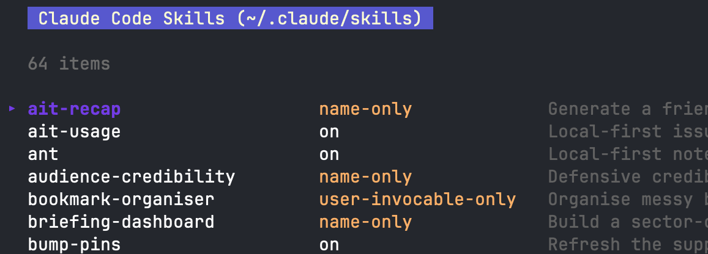

# claude-skill-editor

A TUI for browsing and editing Claude skills, and for controlling how they're presented to Claude — Desktop app and Claude Code CLI.



## Why this exists

The Claude Desktop app lets you install skills but gives you no way to edit them afterwards. Want to fix a typo? Re-upload a zip. Every time. The files are buried under two levels of UUID directories, so good luck finding them by hand.

Also, even on the CLI I get annoyed having to type `vim ~/.claude/skills/....` realising I've forgotten the name, `ls`, `vim ...`.  

This tool finds your installed skills, lists them, and lets you pick one to edit. It handles both the Desktop app's UUID maze and the CLI's simpler `~/.claude/skills/` folder.

More recently I've wanted to control how much of each skill Claude actually sees at the start of a session — Claude Code's `skillOverrides` setting, where a skill can be fully on, name-only, hidden-but-runnable, or off entirely. There's a built-in editor for it, but it makes you *cycle* through the options one skill at a time, which is death by a thousand keypresses when you've a dozen to change. So this grew a filterable table where a single number key sets a skill's mode.

## Getting started

Grab a pre-built binary from the [releases page](https://github.com/ohnotnow/claude-skill-editor/releases), `chmod +x` it, and put it somewhere on your PATH. Binaries are available for macOS (Intel and Apple Silicon), Linux (amd64 and arm64), and Windows.

Or build from source if you have Go 1.24+:

```bash
git clone https://github.com/ohnotnow/claude-skill-editor.git
cd claude-skill-editor
go build -o skill-editor .
```

## Usage

Run it with no arguments to browse Desktop app skills. It opens files in a GUI editor (TextEdit on macOS, xdg-open/gedit on Linux).

```bash
skill-editor
```

Use `--cli` to browse Claude Code skills from `~/.claude/skills/` instead. This uses your `$EDITOR` (falls back to nano).

```bash
skill-editor --cli
```

Other options:

```
skill-editor --list         List Desktop skills
skill-editor --cli --list   List CLI skills
skill-editor --open         Open skills directory in your file manager
skill-editor --help         Show all options
```

### TUI controls

| Key | Action |
|-----|--------|
| enter | Open a skill / edit a file |
| o | Open the skill folder in your file manager |
| p | Print the full path and exit (useful for scripting) |
| / | Filter the list: names starting with what you type come first, then names containing it, then skills with a description word starting with it |
| 1–4 | Set a skill's presentation mode — `--cli` only (home table, or a skill's file list) |
| esc, q | Go back / quit |

The `p` key is handy when you just want the path. The TUI tears down cleanly before printing, so you can pipe or copy the output.

### Presentation modes (`--cli`)

Claude Code decides how much of each skill it surfaces to itself via the `skillOverrides` map in `~/.claude/settings.json`. In `--cli` mode, the home screen **is** that table — every skill listed with its current mode:

| Key | Mode | What Claude sees |
|-----|------|------------------|
| `1` | on | Name and description (the default) |
| `2` | name-only | Name only |
| `3` | user-invocable-only | Nothing — but you can still run it yourself with `/skill-name` |
| `4` | off | Nothing; hidden entirely |

Move or filter to a skill and hit `1`–`4` to set its mode — it saves immediately (no prompt; the red/amber colour tells you it took). Setting a skill to `on` simply removes its override, since a skill that's absent from `skillOverrides` is already treated as `on`, so your settings file stays tidy.

You can also set the mode from inside a single skill's file list: open it with `enter`, then press `1`–`4`.

Only the `skillOverrides` block is rewritten. Everything else in `settings.json` keeps its content and its place in the file, and a new `skillOverrides` block goes at the end. The file is saved with two-space indentation, which is how Claude Code writes it anyway, so unless you've hand-formatted yours, only the changed line moves.

### Shell aliases

Add one or both to your `.bashrc` / `.zshrc`:

```bash
alias cse='skill-editor --cli'    # CLI skills, opens in $EDITOR
alias csed='skill-editor'         # Desktop skills, opens in GUI editor
```

## Where skills actually live

Desktop app skills are buried under a platform-specific path with two levels of UUID subdirectories:

- macOS: `~/Library/Application Support/Claude/local-agent-mode-sessions/skills-plugin/<uuid>/<uuid>/skills/`
- Linux: `~/.config/Claude/local-agent-mode-sessions/skills-plugin/<uuid>/<uuid>/skills/`

The tool walks these for you. If you have multiple profiles (UUID sets), it shows a short prefix tag so you can tell them apart.

CLI skills are simpler: `~/.claude/skills/<skill-name>/SKILL.md`. No UUID nesting.

## Licence

MIT. See [LICENSE](LICENSE).
